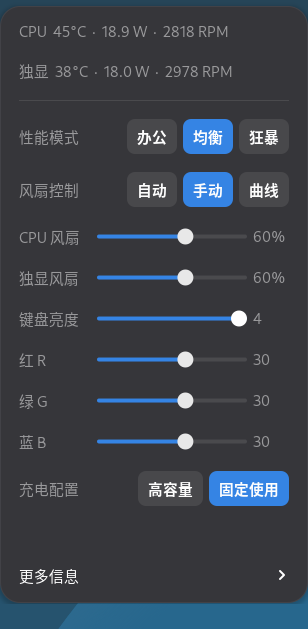
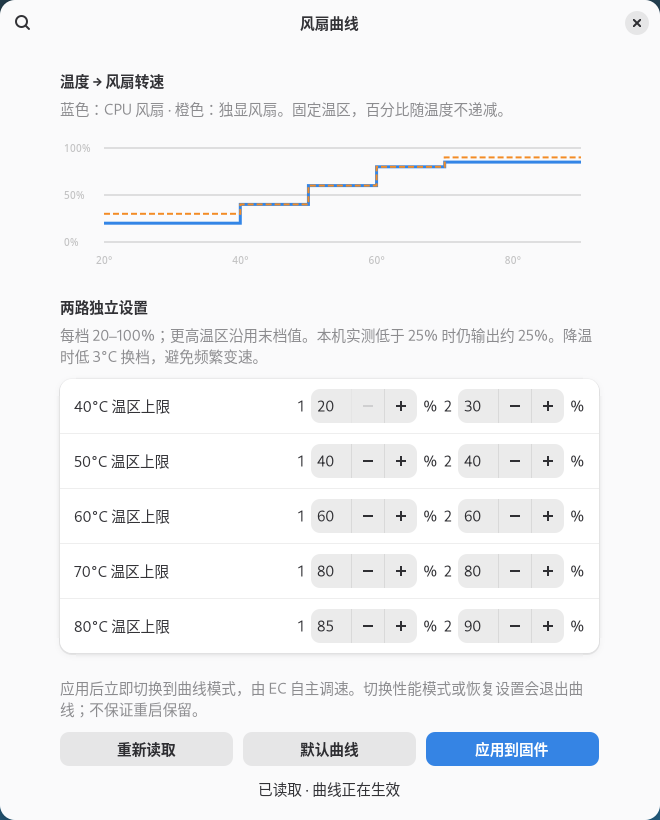

# Mechrevo Control

面向 **Debian 13 / GNOME 48** 的机械革命笔记本控制工具。C 内核驱动提供硬件接口，Zig 服务负责 D-Bus 与授权，GNOME 扩展提供顶栏监测和控制菜单。

当前版本：**1.0.0** · [更新记录](CHANGELOG.md) · [发布下载](https://github.com/Asa-Dong/mechrevo-control/releases) · [开发指南](CONTRIBUTING.md)

## 功能

- CPU 与 NVIDIA 独显的温度、功耗、对应风扇转速；复用 NVML 会话以允许独显自动休眠，休眠时只读状态并显示功耗不可用。
- 办公、均衡、狂暴三档模式，以及实体模式键切换。
- 固件自动风扇、双通道 0–100% 手动调速、EC 自主执行的风扇曲线。
- 键盘亮度 0–4、RGB 每色 0–50。
- 高容量／固定使用充电配置。

### 界面预览

主菜单：温度、功耗、转速和常用控制。截图来自独立 GNOME 测试会话，数值仅为示例。



曲线编辑器：两路五档曲线，固定温区、百分比非递减。



## 已验证硬件

以下型号由本机 DMI、PCI 和驱动信息读取，**不是通用机械革命兼容列表**。

| 项目 | 本机配置 |
| --- | --- |
| 品牌 / 产品 | MECHREVO / JIAOLONG Series（机械革命蛟龙系列） |
| 主板 | `JIAOLONG Series-X6xR55xK` |
| CPU | AMD Ryzen 9 9955HX，16 核 32 线程 |
| 独立显卡 | NVIDIA GeForce RTX 5070 Ti Laptop GPU，PCI `10de:2f18` |
| 集成显卡 | AMD Granite Ridge Radeon Graphics，PCI `1002:13c0` |
| BIOS | `N.1.12MRO13` |
| 系统 / 桌面 | Debian 13 / GNOME Shell 48.7 |
| 已构建内核 | `6.12.116+deb13-amd64`、`6.19.13+deb13-amd64` |

驱动按 DMI 和 EC 能力检查匹配；其他机型尚未验证。[硬件调查记录](docs/HARDWARE.md)包含寄存器来源与验证范围。CPU／GPU 风扇命名依据参考协议及本机曲线实验，不代表两侧散热管路完全独立。

## 设置的保留行为

启动和睡眠恢复只读取硬件当前状态。停止服务、卸载驱动、重启／关机和睡眠时不主动还原设置；没有配置文件保存、开机重放或 BIOS Flash 写入。硬件跨重启能否保留，以重新读取的结果为准。

“恢复默认值”恢复本次接管前的性能、灯光、充电设置，并切回固件自动风扇，**不是 BIOS 出厂重置**。手动风扇依赖驱动定期下发，驱动卸载／睡眠后停止，恢复时不自动续发；自定义曲线由 EC 执行。

充电配置不是百分比上限，实际充电效果仍待验证。三档性能差异、断电／重启保留以及实际睡眠恢复仍有验证边界，1.0.0 不表示这些项目已全部验证。

## 构建

需要 Zig **0.14.1**、Python 3（仅构建检查）、`libsystemd-dev`、`pkg-config`、`zip`、C 编译工具；驱动还需要匹配内核的头文件。

```sh
sudo apt install build-essential libsystemd-dev pkg-config zip python3 dkms linux-headers-$(uname -r)
# 将 Zig 0.14.1 放入 PATH，或设置 ZIG=/绝对路径/zig
zig build test
sh scripts/package.sh
make -C /lib/modules/"$(uname -r)"/build M="$PWD/driver" W=1 modules
./zig-out/bin/mechrevo-control --version
```

产物位于 `dist/`。运行服务无需 Python 或 Zig 编译器；GPU 监测使用 NVIDIA 驱动提供的 NVML。

## 安装与卸载

从源码构建后执行以下命令；也可下载 Release 中的 Linux 二进制包，解压后直接执行同样的安装命令。驱动仍通过 DKMS 针对本机内核编译。

```sh
sudo sh scripts/install-system.sh
# 以下作为普通桌面用户执行
gnome-extensions install --force dist/mechrevo-control@local.shell-extension.zip
gnome-extensions enable mechrevo-control@local
```

安装脚本设置 DKMS、系统服务、D-Bus/Polkit 规则及开机模块加载。更新扩展后，Wayland 桌面需要注销再登录以加载新版。不要与完整 TUXEDO/Uniwill 控制驱动同时使用同一 WMI 设备；Secure Boot 使用本机 DKMS 签名配置。

默认 Polkit 允许活动本地桌面会话直接控制；远程、非活动会话及无桌面会话账户被拒绝。sysfs 写入仍限 root。

只读用户服务可通过 `sh scripts/install-user.sh` 安装。已安装系统服务时无需同时运行用户服务。

```sh
sudo sh scripts/uninstall-system.sh
gnome-extensions uninstall mechrevo-control@local
```

## 项目结构与文档

| 路径 | 内容 |
| --- | --- |
| `driver/` | C WMI/hwmon 驱动、DKMS 配置和[接口文档](driver/README.md) |
| `src/` | Zig 服务：入口/授权、控制校验、状态采集、功耗监测 |
| `extension/` | GNOME 菜单、偏好窗口、曲线编辑器 |
| `data/` | systemd、D-Bus、Polkit 配置 |
| `scripts/` | 检查、构建、安装、打包和发布脚本 |
| `tests/` | 无硬件单元测试、D-Bus/UI 测试、显式实机测试 |
| `diagnostics/` | 历史协议调查模块，不属于产品运行依赖 |
| `docs/validation/` | 历史实测记录，描述对应版本而非统一的当前行为 |

- [D-Bus 接口](docs/API.md)
- [测试说明](tests/README.md)
- [开发与发布](CONTRIBUTING.md)
- [后续验证事项](docs/PLAN.md)

## 开发说明

本项目由 **OpenAI Codex（AI 编程代理）** 根据项目维护者提出的需求开发，涵盖代码实现、问题排查、测试、文档整理和发布准备。项目维护者提供需求、反馈与本机硬件验证环境。

## 参考项目与致谢

| 项目 | 本项目参考内容 |
| --- | --- |
| [TUXEDO tuxedo-drivers](https://gitlab.com/tuxedocomputers/development/packages/tuxedo-drivers) | `v4.25.0_rc` 的 Uniwill WMI/EC 协议、控制字段与风扇事务；上游 GPL-2.0-or-later |
| [sklynic/pkgbuild-mechrevo-driver-dkms-16-pro](https://github.com/sklynic/pkgbuild-mechrevo-driver-dkms-16-pro) | 机械革命机型匹配、补丁、键盘事件与 DKMS 打包参考；固定提交 `af56c84451d6e003267a886183b7deb94ec4476a` |
| [nemoiwkryang/Open-Mechrevo-FanSlider](https://github.com/nemoiwkryang/Open-Mechrevo-FanSlider) | EC RAM 曲线表、启用位、CPU/GPU 通道命名；MIT，固定提交 `c6665cfc15b7ceb0d08111ea317d9ceccc2feb2e` |
| [Linux Uniwill 驱动](https://github.com/torvalds/linux/tree/master/drivers/platform/x86/uniwill) | hwmon 转速读取与平台驱动结构参考 |

本项目不是完整 TUXEDO 驱动的直接打包，参考协议均结合本机诊断验证。第三方克隆不随仓库或发布包分发，恢复方式见 [references/README.md](references/README.md)。已有代码中的上游版权声明予以保留。

## 许可证

项目按 [GPL-2.0-only](LICENSE) 发布。驱动中的上游版权和协议来源声明见 [driver/mechrevo_control.c](driver/mechrevo_control.c)；参考项目保留各自许可证。
